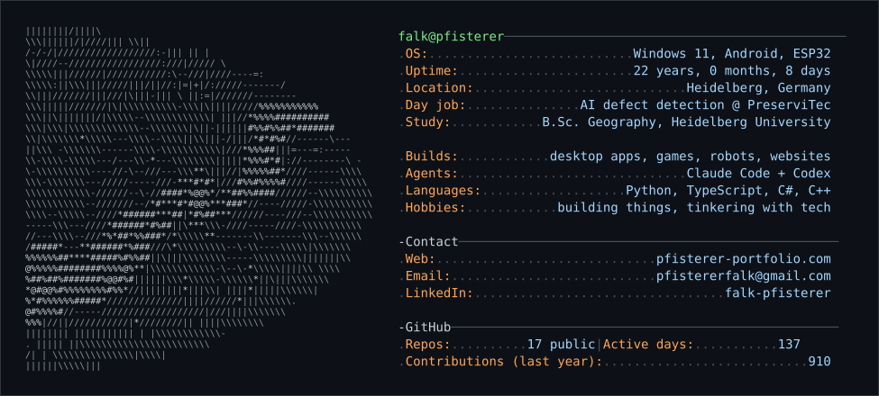
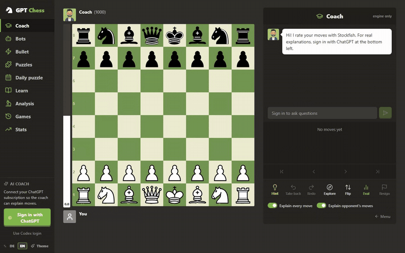
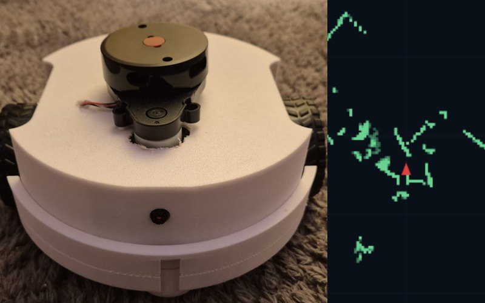
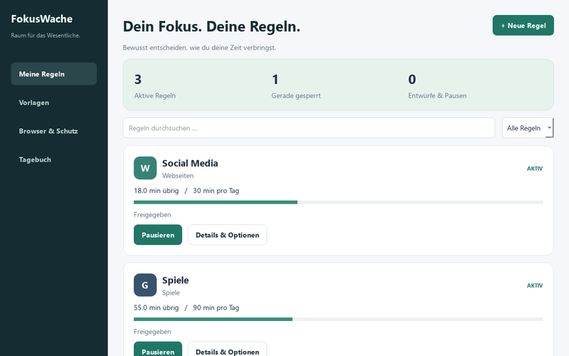
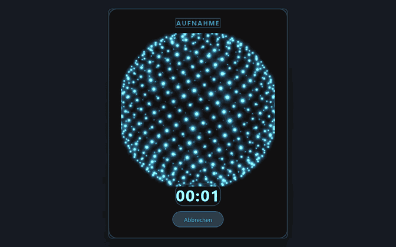

<picture>
  <source media="(prefers-color-scheme: dark)" srcset="header-dark.svg">
  <source media="(prefers-color-scheme: light)" srcset="header-light.svg">
  
</picture>

  <a href="https://pfisterer-portfolio.com">Portfolio</a> ·
  <a href="https://www.linkedin.com/in/falk-pfisterer-6a48a331b/">LinkedIn</a> ·
  <a href="mailto:pfistererfalk@gmail.com">Email</a>

<table>
  <tr>
    <td width="50%" valign="top">
      
       <b><a href="https://github.com/Dolcruz/gpt-chess">GPT Chess</a></b> 
      Chess coach that rates every move and explains it, powered by your own ChatGPT subscription.
    </td>
    <td width="50%" valign="top">
      
       <b><a href="https://github.com/Dolcruz/satsuma">Satsuma</a></b> · <a href="https://github.com/Dolcruz/satsuma/releases/latest">Download</a> 
      Drag a file, tap Shift, drop it on a format. Offline converter wheel for Windows.
    </td>
  </tr>
  <tr>
    <td width="50%" valign="top">
      
       <b><a href="https://github.com/Dolcruz/esp32-roomba">ESP32 Roomba</a></b> 
      Self-built robot: LiDAR mapping, live camera and Gemini Vision navigation from the browser.
    </td>
    <td width="50%" valign="top">
      
       <b><a href="https://github.com/Dolcruz/Fokuswache">FokusWache</a></b> · <a href="https://github.com/Dolcruz/Fokuswache/releases/latest">Download</a> 
      Windows focus app: time budgets and schedules for sites, games and apps. Data stays local.
    </td>
  </tr>
  <tr>
    <td width="50%" valign="top">
      
       <b><a href="https://github.com/Dolcruz/Speech-to-text-desktop">Speech-to-text</a></b> · <a href="https://github.com/Dolcruz/Speech-to-text-desktop/releases/latest">Download</a> 
      Voice typing for Windows with a 3D particle sphere that reacts to your voice, plus grammar fixes and translation.
    </td>
    <td width="50%" valign="top">
      <b>Also built</b>
      <ul>
        <li><a href="https://github.com/Dolcruz/ocr-hotkey">ocr-hotkey</a>: OCR any screen region on a hotkey</li>
        <li><a href="https://github.com/Dolcruz/CampusConnect">CampusConnect</a>: one-click university VPN</li>
        <li><a href="https://github.com/Dolcruz/schneepegel-brotenau">schneepegel-brotenau</a>: snow depth from a fixed camera</li>
        <li><a href="https://github.com/Dolcruz/tree-status-classification-vlm">tree-status-classification-vlm</a>: tree health from drone point clouds, 97.86 % accuracy</li>
        <li><a href="https://github.com/Dolcruz/Heidelberg-Events">Heidelberg-Events</a>: daily scraped event listing</li>
        <li><a href="https://github.com/Dolcruz/Bike_Route_Mapper">Bike_Route_Mapper</a>: community bike routes for Heidelberg</li>
        <li><a href="https://github.com/Dolcruz/desktop-widgets">desktop-widgets</a>: todo, notes and weather embedded in the wallpaper</li>
      </ul>
    </td>
  </tr>
</table>

Header regenerated daily by <a href="scripts/build_header.py">a small script</a> and GitHub Actions.
